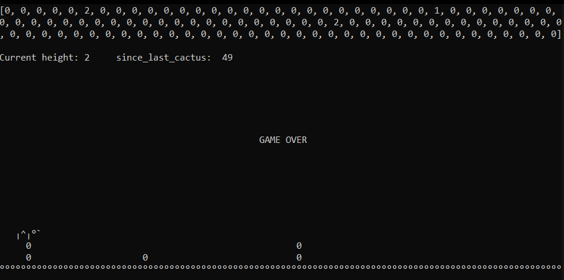
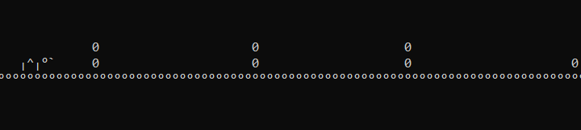

<div align="center">
<h1>tdino</h1>
  
The Chrome Dino game - in a CLI <br><br>


</div>

## What?!...
Some people have time on hands others have not... and motivaton to learn and teach. This is the simple CLI implementation of the chrome dino game. 

## Why...
We all know and love the chrome dino game! But what if we bring it to the CLI? Chars and not pixels - may this be my maxime, besides from proper documentation. The main goal here is not to create a full game, but rather to create an insight for people which have never thought of developing games in the CLI. **The document found in the repository is handcrafted and well-commented so that it can be read as a document, rather than a coded script.**


## How...

First of all, you'll need python. Download and install python in any version applicable. Then, you'll need the following library:
```
py -m pip install blessed
```

This library is our wrapper for the CLI we will work with providing a pleasant expirience. So, after the steps 1 and 2:

1. Install python
2. Install blessed
3. Download the scipt
4. Start the script via a CLI
5. Play

If you want to understand what and how it was done, just look inside. There are many features to be implmented, but i somehow enjoy such a raw expirience. This is how it looks:
<div align="center">

</div>
<br>

*This project took 3.3h total*

## Triccy!

Thats the name of the dino. He's a nice one. 
```
╷^╷°`
```


## Thanks...

...for looking by.

<div align="center">
<br>
Crafted with ❤️ for [Hack Club](https://hackclub.com/)
</div>
